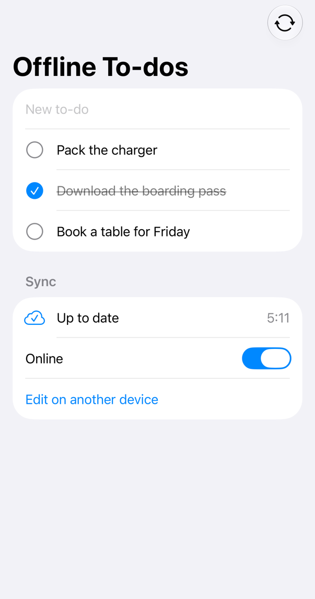
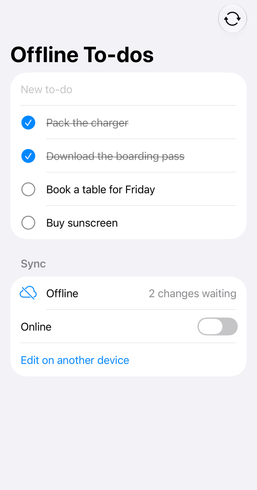
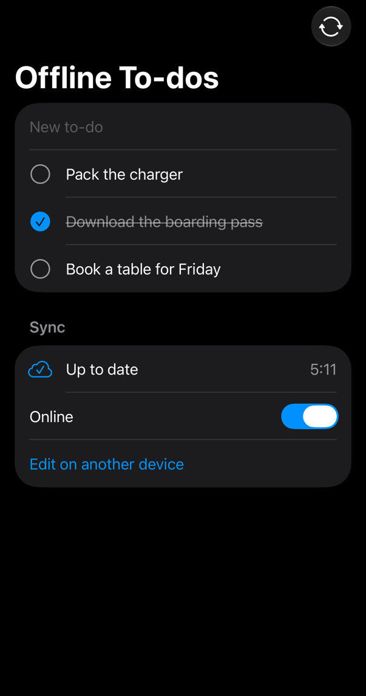
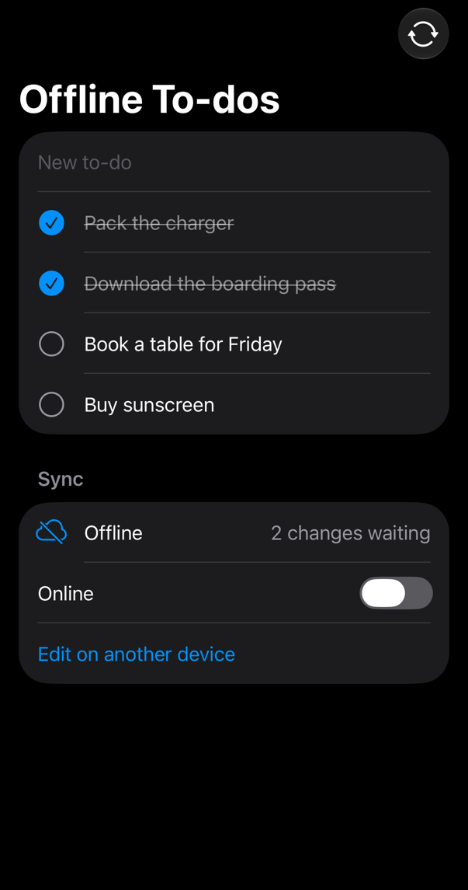

<!-- i18n-source: README.md@1822dd1cede2ddb1e685b1ff9c27e7b5d7d5f0c5 status=reviewed -->
<!-- brand:start -->

<p align="center"><picture><source media="(prefers-color-scheme: dark)" srcset="https://raw.githubusercontent.com/muhittincamdali/iOS-Offline-First-Framework/master/.github/brand/banner-zh-CN-dark.svg"><source media="(prefers-color-scheme: light)" srcset="https://raw.githubusercontent.com/muhittincamdali/iOS-Offline-First-Framework/master/.github/brand/banner-zh-CN-light.svg"></picture></p>

<!-- lang-selector:start -->
<p align="center"><a href="README.md">English</a> · <a href="README.tr.md">Türkçe</a> · <a href="README.zh-CN.md">简体中文</a> · <a href="README.ja.md">日本語</a> · <a href="README.ko.md">한국어</a> · <a href="README.es.md">Español</a> · <a href="README.de.md">Deutsch</a> · <a href="README.fr.md">Français</a> · <a href="README.pt-BR.md">Português (Brasil)</a> · <a href="README.ru.md">Русский</a></p>
<!-- lang-selector:end -->

<p align="center">
<a href="https://github.com/muhittincamdali/iOS-Offline-First-Framework/actions/workflows/ci.yml"></a>
<a href="https://github.com/muhittincamdali/iOS-Offline-First-Framework/releases"><picture><source media="(prefers-color-scheme: dark)" srcset="https://raw.githubusercontent.com/muhittincamdali/iOS-Offline-First-Framework/master/.github/brand/badge-version-dark.svg"><source media="(prefers-color-scheme: light)" srcset="https://raw.githubusercontent.com/muhittincamdali/iOS-Offline-First-Framework/master/.github/brand/badge-version-light.svg"></picture></a>
<a href="https://github.com/muhittincamdali/iOS-Offline-First-Framework/blob/master/Package.swift"><picture><source media="(prefers-color-scheme: dark)" srcset="https://raw.githubusercontent.com/muhittincamdali/iOS-Offline-First-Framework/master/.github/brand/badge-platforms-dark.svg"><source media="(prefers-color-scheme: light)" srcset="https://raw.githubusercontent.com/muhittincamdali/iOS-Offline-First-Framework/master/.github/brand/badge-platforms-light.svg"></picture></a>
<a href="https://github.com/muhittincamdali/iOS-Offline-First-Framework/blob/master/Package.swift"><picture><source media="(prefers-color-scheme: dark)" srcset="https://raw.githubusercontent.com/muhittincamdali/iOS-Offline-First-Framework/master/.github/brand/badge-language-dark.svg"><source media="(prefers-color-scheme: light)" srcset="https://raw.githubusercontent.com/muhittincamdali/iOS-Offline-First-Framework/master/.github/brand/badge-language-light.svg"></picture></a>
<a href="https://github.com/muhittincamdali/iOS-Offline-First-Framework/blob/master/LICENSE"><picture><source media="(prefers-color-scheme: dark)" srcset="https://raw.githubusercontent.com/muhittincamdali/iOS-Offline-First-Framework/master/.github/brand/badge-license-dark.svg"><source media="(prefers-color-scheme: light)" srcset="https://raw.githubusercontent.com/muhittincamdali/iOS-Offline-First-Framework/master/.github/brand/badge-license-light.svg"></picture></a>
</p>

<p align="center">
<a href="#快速开始"><picture><source media="(prefers-color-scheme: dark)" srcset="https://raw.githubusercontent.com/muhittincamdali/iOS-Offline-First-Framework/master/.github/brand/button-start-zh-CN-dark.svg"><source media="(prefers-color-scheme: light)" srcset="https://raw.githubusercontent.com/muhittincamdali/iOS-Offline-First-Framework/master/.github/brand/button-start-zh-CN-light.svg"></picture></a>
<a href="https://muhittincamdali.github.io/iOS-Offline-First-Framework/documentation/offlinefirstframework/"><picture><source media="(prefers-color-scheme: dark)" srcset="https://raw.githubusercontent.com/muhittincamdali/iOS-Offline-First-Framework/master/.github/brand/button-docs-zh-CN-dark.svg"><source media="(prefers-color-scheme: light)" srcset="https://raw.githubusercontent.com/muhittincamdali/iOS-Offline-First-Framework/master/.github/brand/button-docs-zh-CN-light.svg"></picture></a>
<a href="https://github.com/muhittincamdali/iOS-Offline-First-Framework/tree/master/Examples"><picture><source media="(prefers-color-scheme: dark)" srcset="https://raw.githubusercontent.com/muhittincamdali/iOS-Offline-First-Framework/master/.github/brand/button-examples-zh-CN-dark.svg"><source media="(prefers-color-scheme: light)" srcset="https://raw.githubusercontent.com/muhittincamdali/iOS-Offline-First-Framework/master/.github/brand/button-examples-zh-CN-light.svg"></picture></a>
</p>

> 本文是英文 README 的译文。如两者内容不一致，以英文版为准。

<!-- brand:end -->
这是一个 Swift 软件包：它把应用的记录保存在设备上的文件里，将每次改动放入队列，并在有网络连接时与你的服务器同步。保存操作从不等待网络，因此应用在飞机上、地下室里或信号时断时续的火车上，表现完全一致。当同一条记录在两台设备上都被修改时，由你选择的冲突策略决定保留哪一份。它可以配合任何后端：带有参考服务器的轻量 HTTP 协议、通过两个函数的协议接入你自己的 API，或者用于测试和预览的内存服务器。该软件包没有任何依赖。

## 亮点

- **写入从不等待** — `save` 和 `delete` 会写入一个以原子方式写出的文件，以及一个重启后依然保留的持久化待同步队列；推送失败时按指数退避（exponential backoff）加抖动（jitter）重试，在最后一次尝试后会被搁置，而不是丢失。
- **有意识地决定冲突** — 基于混合逻辑时钟时间戳的最后写入者优先（时间戳不会倒退，并让每台设备得到相同的顺序）、服务器优先、客户端优先、你自己的合并逻辑，或者无冲突字段：`LWWRegister`、`LWWMap`、`GCounter`、`PNCounter` 和 `ORSet`。
- **任何后端** — `HTTPSyncTransport` 使用一套有文档的 JSON 协议，[`Examples/SyncServer`](Examples/SyncServer) 中的参考服务器用大约 280 行 JavaScript 实现了它；任何其他 API 都可以接在 `SyncTransport` 之后，例如使用 ETag 的 REST API。
- **为 SwiftUI 而生** — `SyncedCollection` 是存储的 `@Observable` 模型；设备联网时以及本地编辑之后不久会自动同步，也可以通过一次调用在后台刷新任务中同步。
- **静态数据受保护** — 使用保存在 Keychain 中的密钥进行 AES-GCM 文件加密、数据保护级别、记录架构迁移，以及针对损坏文件的处理策略。
- **针对真实服务器测试** — 在 macOS 和 iPhone 模拟器上运行 350 个 Swift Testing 测试，其中包括两个让每种冲突策略经受请求丢失、重启、令牌重置、重叠同步、较小页数上限、过期页面、同时进行的操作和崩溃考验、也针对不发送 `sequence` 的服务器的属性测试，在多次同步中持续回应同一台设备的副本、带回设备自己更早写入或遇上已被接受的推送的过期页面、在一次同步的每次写入时崩溃以及设备时钟向前跳变的场景测试，以及发送无用数据页面、嵌套极深的记录、大于应答上限的页面和改动多于所请求数量的页面（也包括通过套接字无休止地传输）的测试；为服务器编写了 28 个 Node 测试，并在 CI 中有一套端到端测试，通过 HTTP 经由服务器同步存储，也包括跨越一次服务器重启的 68 条 250 KiB 记录、合计超过应答上限的 70 个 250 KiB 冲突应答、一次保存失败的写入在重启之后的情况、服务器在回应 504 的代理之后应用的一次推送，以及在令牌重置后提供重启之前页面的副本。

### 内容一览

| 领域       | 类型                                                                                                                 |
| ---------- | -------------------------------------------------------------------------------------------------------------------- |
| 存储       | `OfflineStore`, `SyncableRecord`, `SyncStatus`, `SyncReport`, `StoreState`, `PendingChange`                          |
| 服务器连接 | `SyncTransport`, `HTTPSyncTransport`, `InMemorySyncServer`, `OutgoingChange`, `RemoteChange`, `PushOutcome`          |
| 冲突       | `ConflictResolver`, `Conflict`, `ConflictResolution`, `Mergeable`                                                    |
| 无冲突字段 | `LWWRegister`, `LWWMap`, `GCounter`, `PNCounter`, `ORSet`                                                            |
| 同步控制   | `RetryPolicy`, `CircuitBreaker`, `ConnectivityMonitor`, `NetworkConnectivityMonitor`, `SimulatedConnectivity`        |
| 持久化     | `FileStore`, `InMemoryStorage`, `StorageBackend`, `StoreEncryption`, `KeychainStore`, `RecordMigration`, `JSONValue` |
| 时钟       | `HybridLogicalClock`, `HLCTimestamp`, `VectorClock`                                                                  |
| SwiftUI    | `SyncedCollection`                                                                                                   |

## 快速开始

**1. 添加软件包**

在 Xcode 中选择 **File › Add Package Dependencies…**，然后输入仓库地址：

```text
https://github.com/muhittincamdali/iOS-Offline-First-Framework.git
```

将其粘贴到窗口右上角的搜索框中。把 **Dependency Rule** 保持为从 `2.0.0` 开始的 **Up to Next Major Version**，然后点击 **Add Package**。在接下来的窗口中，在 **OfflineFirstFramework** 旁边选择你的应用 target，再次点击 **Add Package**。

**2. 导入模块**

```swift
import OfflineFirstFramework
```

把这一行放在你使用存储的 Swift 文件顶部，紧挨着 `import SwiftUI`。

**3. 开始使用**

在新建的 Xcode 应用中（**File › New › Project… › App**，iOS 17 或更高版本），将 `ContentView.swift` 中的全部内容替换为：

```swift
import OfflineFirstFramework
import SwiftUI

/// A to-do item. Any `Codable` struct with an `id` can be a record.
struct Todo: SyncableRecord, Hashable {
    var id = UUID()
    var title: String
    var isDone = false
}

enum TodoStore {
    // InMemorySyncServer stands in for a backend; swap in HTTPSyncTransport or your own
    // SyncTransport when you have one. The initializer throws only for an invalid name or a
    // store file it cannot read.
    static let shared = try! OfflineStore<Todo>(name: "todos", transport: InMemorySyncServer<Todo>())
}

struct ContentView: View {
    @State private var todos = SyncedCollection(store: TodoStore.shared)
    @State private var newTitle = ""

    var body: some View {
        NavigationStack {
            List {
                TextField("New to-do", text: $newTitle)
                    .onSubmit {
                        let todo = Todo(title: newTitle)
                        newTitle = ""
                        Task { await todos.save(todo) }
                    }
                ForEach(todos.records) { todo in
                    Text(todo.title)
                }
            }
            .navigationTitle("To-dos")
            .toolbar {
                Text("\(todos.pendingCount) to sync")
            }
            .refreshable { await todos.sync() }
        }
    }
}
```

按 **Run**（⌘R）。输入一个待办事项并按回车：它会立刻出现并保存在设备上，工具栏显示 **1 to sync**。下拉列表即可同步，计数器回到 0。退出并重新打开应用：待办事项依然都在。在你连接真正的后端之前，`InMemorySyncServer` 会代替它（参见[使用方法](#使用方法)）。

## 安装

### Swift Package Manager

在 Xcode 中选择 **File › Add Package Dependencies…**，然后输入仓库地址：

```text
https://github.com/muhittincamdali/iOS-Offline-First-Framework.git
```

或者将其添加到 `Package.swift` 的 `dependencies` 中：

```swift
dependencies: [
    .package(url: "https://github.com/muhittincamdali/iOS-Offline-First-Framework.git", from: "2.0.0")
],
targets: [
    .target(name: "YourApp", dependencies: [
        .product(name: "OfflineFirstFramework", package: "iOS-Offline-First-Framework")
    ])
]
```

2.0 版取代了 1.0.0 的 API，而 1.0.0 无法作为依赖被解析；具体改动请见[更新日志](CHANGELOG.md)。

## 使用方法

下面的每个示例都复制自 [`ReadmeSamples.swift`](Examples/OfflineTodos/OfflineTodos/ReadmeSamples.swift)，示例应用会编译它，测试套件也会运行它。

### 通过 HTTP 与你的服务器同步

如果你的服务器实现了[服务器协议](Sources/OfflineFirstFramework/OfflineFirstFramework.docc/ServerProtocol.md)的两个端点（`POST <base>/push` 和 `GET <base>/changes?since=<token>`），就使用 HTTP transport。`headers` 闭包会在每次请求之前运行，因此可以获取新的访问令牌：

```swift
let transport = HTTPSyncTransport<Todo>(
    baseURL: URL(string: "http://localhost:8080/sync/todos")!,
    headers: { ["Authorization": "Bearer \(try await token())"] }
)
let store = try OfflineStore<Todo>(name: "todos", transport: transport)
```

`http://localhost:8080` 是你用 `node Examples/SyncServer/server.mjs` 启动参考服务器时它监听的地址；请把它替换为你自己服务器的 URL。

### 连接现有 API

任何 API 都可以接在 `SyncTransport` 之后：一个函数发送本地改动并为每条改动报告结果，另一个函数返回某个变更令牌之后的服务器改动。下面这个示例把存储映射到一个用 ETag 为记录做版本控制的 REST API 上：

```swift
/// A transport for an existing REST API that versions records with ETags:
/// `PUT /todos/<id>` and `DELETE /todos/<id>` with `If-Match`, `GET /todos?since=<token>`.
struct TodoAPI: SyncTransport {
    var baseURL: URL
    var session = URLSession.shared

    func push(_ changes: [OutgoingChange<Todo>]) async throws -> [UUID: PushOutcome<Todo>] {
        var outcomes: [UUID: PushOutcome<Todo>] = [:]
        for change in changes {
            var request = URLRequest(url: baseURL.appending(path: "todos/\(change.recordID)"))
            request.httpMethod = change.record == nil ? "DELETE" : "PUT"
            request.httpBody = try change.record.map { try JSONEncoder().encode($0) }
            request.setValue(change.baseRevision ?? "*", forHTTPHeaderField: change.baseRevision == nil ? "If-None-Match" : "If-Match")
            let (data, response) = try await session.data(for: request)
            let http = response as? HTTPURLResponse
            let etag = http?.value(forHTTPHeaderField: "ETag") ?? ""
            switch http?.statusCode ?? 0 {
            case 200...204:
                outcomes[change.id] = .accepted(revision: etag)
            case 412:
                // The server sends its current version with the failed precondition.
                let current = data.isEmpty ? nil : try JSONDecoder().decode(Todo.self, from: data)
                outcomes[change.id] = .conflict(current: RemoteChange(recordID: change.recordID, record: current, revision: etag, timestamp: nil))
            case 422:
                outcomes[change.id] = .rejected(reason: String(decoding: data, as: UTF8.self), current: nil)
            default:
                // No outcome: the store counts a failed attempt and retries later.
                continue
            }
        }
        return outcomes
    }

    func pull(since token: String?) async throws -> PullResponse<Todo> {
        struct Page: Decodable {
            struct Item: Decodable { var id: UUID; var etag: String; var todo: Todo? }
            var items: [Item]
            var next: String
            var more: Bool
        }
        var url = baseURL.appending(path: "todos")
        if let token { url.append(queryItems: [URLQueryItem(name: "since", value: token)]) }
        let (data, _) = try await session.data(from: url)
        let page = try JSONDecoder().decode(Page.self, from: data)
        let changes = page.items.map { RemoteChange(recordID: $0.id, record: $0.todo, revision: $0.etag, timestamp: nil) }
        return PullResponse(changes: changes, token: page.next, hasMore: page.more)
    }
}
```

transport 必须遵守的规则（revision、重试、幂等性、删除、变更令牌）见文章[连接到你的服务器](Sources/OfflineFirstFramework/OfflineFirstFramework.docc/ConnectingToYourServer.md)。

### 决定冲突

默认策略是最后写入者优先。若要同时保留两个版本中的部分内容，请将它们合并：

```swift
/// A to-do counts as done if either device ticked it; the server's title wins.
static let keepTicks = ConflictResolver<Todo>.merge { local, remote in
    var merged = remote
    merged.isDone = local.isDone || remote.isDone
    return merged
}
```

把它作为 `configuration.conflictResolver` 传入（见下一个示例）。文章[解决冲突](Sources/OfflineFirstFramework/OfflineFirstFramework.docc/ResolvingConflicts.md)介绍了其他策略和无冲突字段类型。

### 加密文件并迁移旧记录

```swift
/// A store with an encrypted file, a custom conflict policy and a schema migration.
static func makeSecureStore(transport: some SyncTransport<Todo>, storage: (any StorageBackend)? = nil) throws -> OfflineStore<Todo> {
    var configuration = OfflineStore<Todo>.Configuration()
    configuration.conflictResolver = keepTicks
    configuration.encryption = try .keychain(account: "todos-key", keychain: KeychainStore(service: "com.example.todos"))
    configuration.schemaVersion = 2
    configuration.migrations = [
        // Version 2 renamed `done` to `isDone`.
        RecordMigration(to: 2) { record in
            record["isDone"] = record["done"] ?? false
            record["done"] = nil
        }
    ]
    return try OfflineStore<Todo>(name: "secure-todos", storage: storage, transport: transport, configuration: configuration)
}
```

### 自动同步

```swift
await TodoStore.shared.startAutomaticSync()
```

之后，存储会在设备联网时、本地改动两秒后、失败的改动到了重试时间时，以及联网期间每五分钟同步一次。错误会显示在 `SyncedCollection.status` 和 `lastError` 中。应用在后台时的同步，请参阅[在后台同步](Sources/OfflineFirstFramework/OfflineFirstFramework.docc/SyncingInTheBackground.md)。

### 无需后端即可测试

`InMemorySyncServer` 的行为与真实服务器一致（revision、冲突、分页拉取、离线开关），因此在单元测试中，两个存储就可以扮演两台设备：

```swift
/// Two devices, one server: the phone writes, the laptop receives the to-do.
static func twoDevices() async throws -> (phone: [Todo], laptop: [Todo]) {
    let server = InMemorySyncServer<Todo>()
    let phone = try OfflineStore<Todo>(name: "phone", storage: InMemoryStorage(), transport: server)
    let laptop = try OfflineStore<Todo>(name: "laptop", storage: InMemoryStorage(), transport: server)

    try await phone.save(Todo(title: "Buy milk"))
    try await phone.sync()
    try await laptop.sync()
    return (await phone.records(), await laptop.records())
}
```

## 保证与限制

只要服务器遵循[协议](Sources/OfflineFirstFramework/OfflineFirstFramework.docc/ServerProtocol.md)，无论使用哪种冲突策略，存储在请求丢失、应答丢失、应用和服务器重启以及过期页面的情况下都会信守以下承诺：

- 保存或删除在调用返回之前就已写入文件，队列中的改动会一直推送，直到服务器给出应答。重试沿用同一个改动 ID，因此服务器只会应用一次。只有读到的应答才能确定一个改动的结果：遇到错误状态、连接中断或长到无法读取的应答之后，该改动会一直处于未定（in doubt）状态，直到下一次推送。
- 过期的副本绝不会覆盖服务器已接受的写入：只有当一条记录在本设备和另一台设备上都发生了变化时才会询问解决器，服务器上较旧的版本会按服务器的 `sequence` 被跳过，在设备自己的写入刚被接受之后、跨越设备尚未察觉的服务器重启时以及调用 `resetChangeToken()` 之后也是如此。设备自己写入的版本永远不算冲突，即使过期页面让记录回退、用户又在其上做了编辑，或者某个页面在一个应答丢失的版本之前列出设备自己更早的写入，也是如此。没有 `sequence` 时，即使页面带回设备自己更早的写入，拉取也会把待处理的改动留给它的推送，由推送的应答来决定，无论是否被接受：拉取在此期间暂存的版本只有在服务器的 `sequence` 表明它更新时才会取代应答。无从判断时，若是冲突，改动会再发送一次以获得新的应答；其他应答保持有效，下一次同步会从头拉取。
- 服务器的另一个 epoch，以及有记录的存储首次得知的 epoch，只有在一次同步中的两个请求（带令牌的拉取和从头开始的拉取）都报告它时才算数，因此过期的缓存或同一 URL 后面的另一个部署既无法让存储回退，也无法把存储挡在不带 epoch 的服务器之外。两个请求报告过 epoch 之后，不带 epoch 的页面也永远不会被接受。每次只拉取一页的同步也能跟上服务器重启；两个请求不一致时，同步会失败，而不是报告成功。epoch 只朝一个方向前进：早于存储当前 epoch 的 epoch，无论是存储离开的还是从未持有的，都永远不会被接受，调用 `resetChangeToken()` 之后也是如此，因此同时回应两个请求的过期副本或缓存，无论连续回应多少次同步，也无法让存储回退。
- 已删除的记录保持删除状态。丢失了数据的服务器或另一台服务器会让存储从头重新拉取全部内容，并保留待同步改动；这些改动通过自己推送的应答、而不是通过页面与新的历史相遇。应用无法解码的记录，或嵌套超过 64 层的记录，会被放进 `quarantinedChanges()`，而不会让拉取停止。
- 服务器应答的开销是有限的。嵌套超过 64 层的记录永远不会进入存储，因此写入文件不会导致栈溢出；充满无用数据、或改动多于拉取所请求数量（最多 1,000 个）的页面会在几毫秒内被拒绝，而不是占用数 GB 内存，并且其下载会被取消；大于应答上限的页面会让拉取请求更少的改动，单独就超过上限的改动在上限的四倍以内会被放在一边；推送会被拆分成服务器请求体上限能接受的请求，当服务器回应 413 或 2xx 应答长于应答上限时，会对半拆分后重新发送，最多额外 16 个请求，单个改动的应答本身就超过上限时该改动保持未定；错误状态的应答只读取前 4 KiB，因此出问题的网关只消耗一次失败的尝试；UTF-8 字节顺序标记可以被读取。
- 走快或被往回调的时钟、对每次推送都回应冲突的服务器、从不应答的服务器以及无法写入的文件，其影响都是有限的：参考服务器保存的推送时间戳最多比自己的时钟领先五分钟，设备时钟短暂出错不会延续到之后的写入，服务器版本从不按时间戳排序（走快的时钟不会隐藏任何之后的版本，也不会让任何改动被搁置），重试会退避并被搁置，一次同步会在 `syncTimeout` 之后结束，文件无法写入期间同步会等待。

服务器绝不能把同一个 revision 分配给一条记录的两个版本，应当在每一页中发送只会前进到更晚值且永不回头的 `epoch`（更长，或长度相同时按字节更大）、在重启后继续计数的 `sequence`（存储使用的唯一顺序）、推送时的时间戳（远超其时钟的时间被拉回到上限）以及写入每个版本的 `changeID`，必须在重启后仍记得改动 ID，只在写入保存之后才在页面中显示它，并让每一页以及对每个推送改动的应答都不超过客户端的应答上限（每页最多 `limit` 个改动，同时按字节截断，每页至少一个改动）。限制：服务器在恢复备份时丢失的写入不会被重新上传；不发送 `sequence` 的服务器没有顺序保证（过期页面可能让记录回退，直到它再次改动，但不会丢失任何写入）；在 `discardChange(for:)` 之后立即再次保存的记录会与服务器的副本作为冲突相遇；每个文件只能有一个存储实例（对 `FileStore`、`InMemoryStorage` 和提供 `claimIdentity` 的自定义后端强制执行）；每次改动都会写入整个文件；记录最多嵌套 64 层；每页最多 1,000 个改动，单个大于应答上限四倍的改动会让拉取停止；推送应答本身大于应答上限的改动保持未定，并在最后一次尝试后被搁置；更早的 epoch 在服务器报告晚于存储的 epoch 之前一直被拒绝，不带 epoch 的页面在服务器再次报告 epoch 之前也一直被拒绝；超过 10,000 条的删除会被遗忘。完整列表见[保证与限制](Sources/OfflineFirstFramework/OfflineFirstFramework.docc/GuaranteesAndLimits.md)。

## 演示

| 已同步                                                          | 离线，有两处改动等待同步                                       |
| --------------------------------------------------------------- | -------------------------------------------------------------- |
|  |  |
|   |   |

这些截图展示的是 iPhone 模拟器上的 [OfflineTodos](Examples/OfflineTodos) 示例应用，由 [`scripts/capture-example-screens.sh`](scripts/capture-example-screens.sh) 截取。在应用中，关闭 **Online**，编辑几个待办事项，再重新打开它，即可观察改动同步；**Edit on another device** 会通过同一服务器上的第二个存储修改一个待办事项。打开 `Examples/OfflineTodos/OfflineTodos.xcodeproj`，选择一个 iPhone 模拟器或 **My Mac**，然后按 **Run**；详情见 [Examples/README.md](Examples/README.md)。

## 文档

API 参考文档与文章：

- [API 参考](https://muhittincamdali.github.io/iOS-Offline-First-Framework/documentation/offlinefirstframework/)
  （DocC，从 `master` 发布到 GitHub Pages）
- 在 Xcode 中通过 **Product › Build Documentation** 在本地构建，或使用命令行：

```sh
xcodebuild docbuild -scheme OfflineFirstFramework -destination 'generic/platform=macOS'
```

## 指南

- [快速上手](https://muhittincamdali.github.io/iOS-Offline-First-Framework/documentation/offlinefirstframework/gettingstarted)
  — 添加软件包、定义记录、打开存储，并在 SwiftUI 中显示
  （[源文件](Sources/OfflineFirstFramework/OfflineFirstFramework.docc/GettingStarted.md)）。
- [连接到你的服务器](https://muhittincamdali.github.io/iOS-Offline-First-Framework/documentation/offlinefirstframework/connectingtoyourserver)
  — HTTP transport、自定义 transport 的规则、内存服务器
  （[源文件](Sources/OfflineFirstFramework/OfflineFirstFramework.docc/ConnectingToYourServer.md)）。
- [服务器协议](https://muhittincamdali.github.io/iOS-Offline-First-Framework/documentation/offlinefirstframework/serverprotocol)
  — 面向后端开发者的 push 和 pull 请求的每个字段
  （[源文件](Sources/OfflineFirstFramework/OfflineFirstFramework.docc/ServerProtocol.md)）。
- [解决冲突](https://muhittincamdali.github.io/iOS-Offline-First-Framework/documentation/offlinefirstframework/resolvingconflicts)
  — 策略、混合逻辑时钟、字段合并和无冲突类型
  （[源文件](Sources/OfflineFirstFramework/OfflineFirstFramework.docc/ResolvingConflicts.md)）。
- [在后台同步](https://muhittincamdali.github.io/iOS-Offline-First-Framework/documentation/offlinefirstframework/syncinginthebackground)
  — 自动同步、重试、断路器（circuit breaker）和后台刷新任务
  （[源文件](Sources/OfflineFirstFramework/OfflineFirstFramework.docc/SyncingInTheBackground.md)）。
- [保护与迁移数据](https://muhittincamdali.github.io/iOS-Offline-First-Framework/documentation/offlinefirstframework/protectingandmigratingdata)
  — 文件存放位置、加密、架构迁移和损坏的文件
  （[源文件](Sources/OfflineFirstFramework/OfflineFirstFramework.docc/ProtectingAndMigratingData.md)）。

## 系统要求

| 平台     | 最低版本 |
| -------- | -------- |
| iOS      | 17       |
| macOS    | 14       |
| tvOS     | 17       |
| watchOS  | 10       |
| visionOS | 1        |
| | 工具链 | Swift 6.2 · Xcode 26+ | |

参考服务器需要 Node 24 或更高版本。

## 架构

- `OfflineStore` 是一个 actor，拥有一个集合。它的状态（记录、待同步改动、变更令牌、时钟）会写成一个 JSON 文件；每次改动都在一份副本上进行，只有写入成功后该副本才会成为当前状态，因此崩溃或磁盘写满都不会留下只应用了一半的改动。每条记录都带有它的服务器 revision、最后一个时间戳，并且在尚未同步时带有一条待同步改动，其 ID 会随每次本地编辑而改变。
- 一次同步会分批推送待同步改动（最旧的优先，并附上它们所基于的 revision），应用每个结果，然后在已保存的变更令牌之后分页拉取服务器改动。在设备和服务器上都发生变化的记录交给 `ConflictResolver`；服务器上较旧的版本会被跳过。推送进行期间所做的编辑会被保留，并在下一次推送。
- `Sync/` 包含 transport 协议、HTTP 与内存 transport、重试策略、断路器（circuit breaker）和连接状态；`Storage/` 包含文件与 Keychain 存储、加密和迁移；`Clock/` 与 `CRDT/` 是用于排序和合并的值类型；`SwiftUI/` 是可观察模型。只有 `OfflineStore`、`InMemorySyncServer` 和 `SyncedCollection` 是引用类型。
- 存储会防范行为异常的服务器和损坏的文件：队列、页面、响应、revision 和变更令牌的大小上限，必须前进的变更令牌，每条记录每次同步最多三次推送，ID 不匹配而被忽略的记录，超出允许时钟偏差的时间戳，以及无法跳出其目录的文件名。测试覆盖了其中的每一项。
- 每次改动都会重写整个文件，这适用于每个存储最多几万条记录的集合。

在本地运行测试：

```sh
swift test                                          # macOS
xcodebuild test -scheme OfflineFirstFramework \
  -destination 'platform=iOS Simulator,name=iPhone 17'
(cd Examples/SyncServer && npm test)                # reference server
node Examples/SyncServer/server.mjs &               # end to end, against the server
OFFLINE_FIRST_SERVER_URL=http://localhost:8080 swift test --filter EndToEnd
OFFLINE_FIRST_NODE=$(command -v node) swift test --filter ServerSaveTests  # a failed save, a restart
```

## 路线图

- 基于 SQLite 的存储后端，适用于大到无法每次改动都重写的集合。
- 基于 CloudKit（`CKSyncEngine`）的 transport，适用于没有自己服务器的应用。
- 只拉取集合的一部分（例如某个项目的记录）。
- 将软件包上架到 Swift Package Index；`.spi.yml` 已经在仓库中。

## 参与贡献

欢迎参与贡献。提交 pull request 之前，请先阅读[贡献指南](https://github.com/muhittincamdali/iOS-Offline-First-Framework/blob/master/CONTRIBUTING.md)和[行为准则](https://github.com/muhittincamdali/.github/blob/main/CODE_OF_CONDUCT.md)。如发现安全问题，请按照[安全策略](https://github.com/muhittincamdali/iOS-Offline-First-Framework/blob/master/SECURITY.md)私下报告。

## 许可证

基于 MIT 许可证发布。详见 [LICENSE](LICENSE)。
